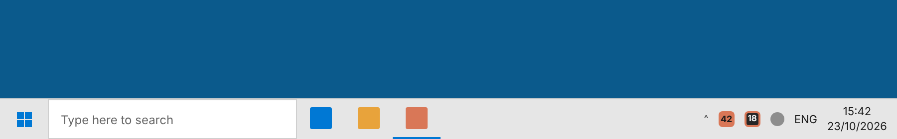

# Claude Status

A small Windows 10/11 utility that shows your **Claude plan usage** on the taskbar and in the
system tray: the 5-hour session limit and the 7-day weekly limit, with time to reset.
It is built for people who use **Claude Desktop / claude.ai only**; it needs neither Claude Code
nor an API key.

> Unofficial and not affiliated with Anthropic. It reads the same numbers as
> claude.ai → Settings → Usage, using undocumented endpoints that may change.

## What it looks like

The images below are rendered previews of the design. Real screenshots from hosted Windows
machines are produced by CI on every push (see [Verification](#verification)).

### Windows 11

Two rows on the taskbar (default):


Compact, one line:


Tray icons only. The filled tile is the 5h session; the outlined tile is the 7d limit:


Details flyout (click the widget or a tray icon):


Limit notification:


### Windows 10





## Features

- **Taskbar widget** next to the notification area, in one of three styles: two rows with bars,
  one compact line, or tray icons only. Drag it sideways to move it. It hides when the taskbar
  auto-hides or a full-screen app is in front, and follows the light/dark Windows mode.
- **Two tray icons**, one for 5h and one for 7d. Each shows the percentage and is coloured by
  level: normal, amber from 70%, red from 90%.
- **Details flyout** with every limit the account has (session, weekly, Opus/Sonnet weekly,
  extra usage) and the local reset times.
- **Windows notifications**, each sent once per limit window:

  | Limit        | Notified at        |
  |--------------|--------------------|
  | 5-hour       | 90%, 100%          |
  | 7-day        | 70%, 90%, 100%     |

- **Sign in once** in a built-in Microsoft Edge (WebView2) window, the same way as on claude.ai.
  The session is stored for the current Windows user only, encrypted with DPAPI.
- **No admin rights** needed to run, and **no .NET install** needed: it ships as a
  self-contained executable.

## Install (single PC)

Download `ClaudeStatus-x64.msi` (or `ClaudeStatus-ARM64.msi`) from the Releases page and run it,
or use the portable `ClaudeStatus-win-x64.exe`.

On first start, click the tray icon and sign in. Windows 11 places new tray icons in the
overflow area; to keep both icons visible, go to **Settings → Personalization → Taskbar →
Other system tray icons** and turn on both *Claude Status* entries.

## Deploying with Group Policy (Active Directory)

### 1. Software installation

1. Copy `ClaudeStatus-x64.msi` to a share that the computer accounts can read, for example
   `\\fileserver\deploy$\ClaudeStatus\`.
2. In **Group Policy Management**, edit a GPO linked to the target computers' OU:
   **Computer Configuration → Policies → Software Settings → Software installation →
   New → Package**, pick the UNC path to the MSI, and choose **Assigned**.
3. The package installs at the next restart. It is per-machine (Program Files), adds a Start
   menu shortcut, and starts automatically for every user at sign-in (an HKLM `Run` entry).

To skip the autostart entry, deploy with `AUTOSTART=0`. Use a transform (`.mst`) for GPO, or
`msiexec /i ClaudeStatus-x64.msi AUTOSTART=0 /qn` for Intune, SCCM or scripts.

Upgrades: add the newer MSI to the same GPO as an upgrade of the existing package. All builds
share one UpgradeCode, so the new version replaces the old one.

### 2. Administrative template (optional)

Copy `policy/ClaudeStatus.admx` to `\\<domain>\SYSVOL\<domain>\Policies\PolicyDefinitions\`
and `policy/en-US/ClaudeStatus.adml` to its `en-US` subfolder (the central store). Settings then
appear under **Computer/User Configuration → Administrative Templates → Claude Status**:

| Policy                        | Registry value (`SOFTWARE\Policies\ClaudeStatus`)  | Effect                                   |
|-------------------------------|------------------------------------------------------|------------------------------------------|
| Refresh interval              | `RefreshMinutes` (DWORD, 1–60)                       | How often usage is checked               |
| Taskbar display               | `WidgetStyle` (DWORD: 0 bars, 1 compact, 2 icons)    | Display style                            |
| Turn off limit notifications  | `DisableNotifications` (DWORD 0/1)                   | Forces notifications off (1) or on (0)   |

A configured policy overrides the user's choice and greys out the matching menu item.
HKLM takes precedence over HKCU.

### What each user still does

Each user signs in to their own Claude account once, from the tray icon. Sessions are personal
and are never stored at machine level.

### Requirements

- Windows 10 (1809 or later) or Windows 11, x64 or ARM64.
- Microsoft Edge WebView2 Runtime, used only for the sign-in window. It ships with Windows 11
  and current Windows 10 builds. If it is missing, deploy the Evergreen WebView2 Runtime first.
- Outbound HTTPS to `claude.ai`.

## Where things are stored

| What                     | Where                                              |
|--------------------------|----------------------------------------------------|
| Settings, session (DPAPI)| `%LOCALAPPDATA%\ClaudeStatus\settings.json`        |
| Sign-in browser profile  | `%LOCALAPPDATA%\ClaudeStatus\WebView2\`            |

**Sign out** in the menu removes the stored session. Uninstalling leaves per-user data in place;
delete the folder above to remove it.

## Building

Requires the .NET 8 SDK on Windows.

```powershell
dotnet publish src/ClaudeStatus -c Release -r win-x64 --self-contained true -p:PublishSingleFile=true -p:DebugType=none -o publish/win-x64
dotnet build installer -c Release -p:Platform=x64 -p:PublishDir=$PWD/publish/win-x64 -p:Version=0.1.0
```

The MSI is built with [WiX Toolset](https://wixtoolset.org/) v5, which is restored from NuGet
automatically. Pushing a `v*` tag builds everything and attaches the MSIs, the portable EXEs and
the policy templates to a GitHub release.

## Verification

The `smoke` job in `.github/workflows/build.yml` runs the built app on hosted **Windows Server
2022** (Windows 10 shell) and **Windows Server 2025** (Windows 11 shell) desktops. It uses demo
data (`ClaudeStatus.exe --demo`), checks that the app keeps running, and uploads screenshots of
the taskbar, the flyout and a notification as build artifacts.

Command-line switches, useful for testing:

| Switch                          | Effect                                         |
|---------------------------------|------------------------------------------------|
| `--demo` / `--demo=alert`       | Sample data, no sign-in, nothing saved         |
| `--style=bars\|compact\|icon`   | Display style for this run                     |
| `--open-details`                | Open the details flyout at start               |

## How it works

- `UsageClient` calls `https://claude.ai/api/organizations` and
  `/api/organizations/{id}/usage` with the signed-in session. Every object in the response that
  has a `utilization` field becomes a limit row, so new limit types appear without code changes.
- `TaskbarWidget` is a borderless, always-on-top, non-activating window placed over the taskbar
  next to the notification area. Windows 11 removed deskbands, so this is how taskbar widgets
  work today.
- `TrayController` draws the two tray icons and owns the menu; `Notifier` sends the threshold
  notifications through the notification area, which Windows shows as native toasts.

## Licence

MIT. See [LICENSE](LICENSE).
