# Claude Status

A small Windows 10/11 utility that shows your **Claude plan usage** on the taskbar and in the
system tray: the 5-hour session limit and the 7-day weekly limit, with time to reset.
It is built for people who use **Claude Desktop / claude.ai only**; it needs neither Claude Code
nor an API key.

> Unofficial and not affiliated with Anthropic. It reads the same numbers as
> claude.ai → Settings → Usage, using undocumented endpoints that may change.

## What it looks like

Real screenshots from the CI smoke test, captured on hosted Windows Server 2025 (Windows 11
shell) and Windows Server 2022 (Windows 10 shell) at 1920×1080 with demo data. The "Test Mode"
watermark comes from the CI host.

### Windows 11

Two rows on the taskbar (default):

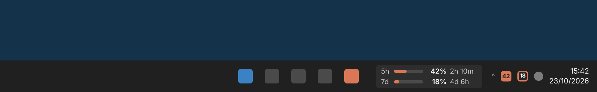

Compact, one line:

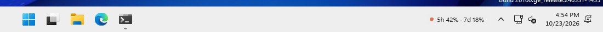

Not signed in yet:

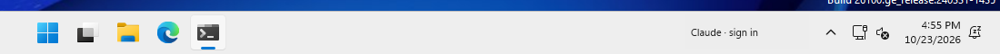

Details flyout (click the widget or a tray icon) with pace marker, trend and forecast:

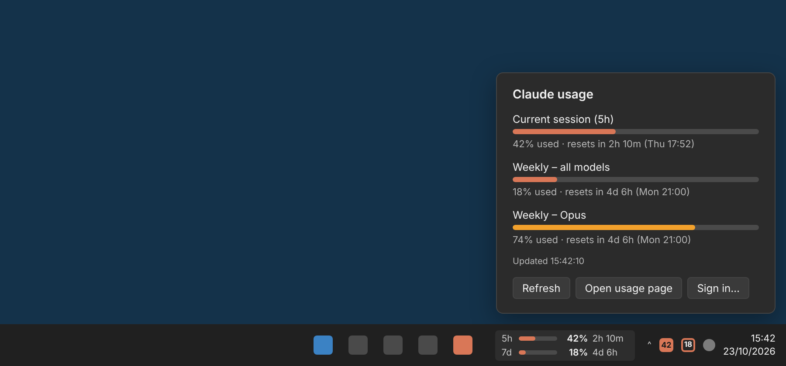

Stats tab (14 days / month / year, heat map, records):

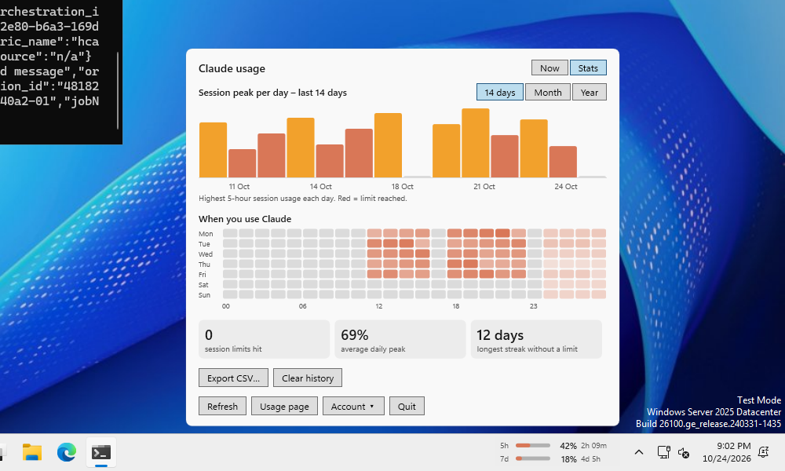

### Windows 10

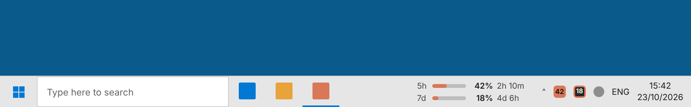

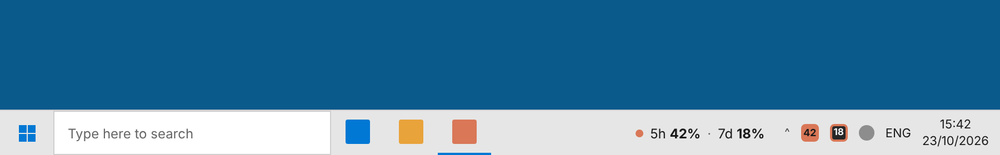


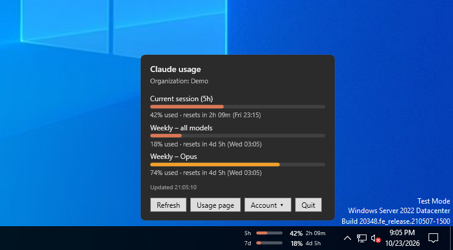

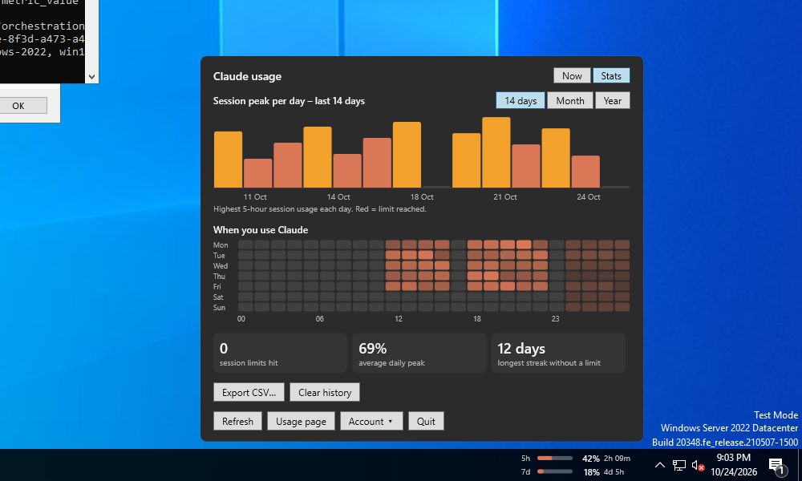

### Tray icons and notifications (rendered previews)

Hosted CI machines keep new tray icons in the overflow area and suppress notifications, so these
two are previews of the design rather than screenshots. The filled tile is the 5h session and the
outlined tile is the 7d limit:

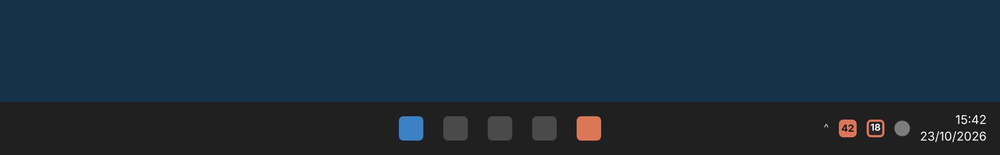

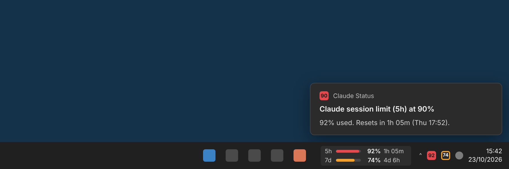

## Features

- **Taskbar widget** next to the notification area, as two rows with bars or one compact line. It
  **never covers taskbar icons**: it appears only when it fits in the free space between the last
  taskbar button and the tray, and otherwise stays hidden. It is also hidden on vertical taskbars,
  when the taskbar auto-hides or a full-screen app is in front. You can drag it sideways within
  that free space, and it follows the light/dark Windows mode.
- **Choose what is shown** under **Display** in the menu: the taskbar widget, the 5-hour tray icon
  and the 7-day tray icon can each be turned on or off, but at least one always stays on (the last
  one is greyed out). If only the widget is on and the taskbar has no room for it, the 5-hour tray
  icon stands in until it fits again. Limit notifications appear either way.
- **Two tray icons**, one for 5h and one for 7d. Each shows the percentage and is coloured by
  level: normal, amber from 70%, red from 90%.
- **Stats**: in the flyout, the 5-hour and 7-day limits show a pace marker (how much of the window
  has passed), a trend line and a forecast ("At this pace you reach the limit around 17:20"). The
  **Stats** tab shows history for **14 days** (default), the **month** or the **year**, a heat map of
  when you use Claude, records, and **Export CSV** / **Clear history**. History stays on the PC (per
  Windows user, account and organisation: 14 days of samples, a daily summary for about 400 days),
  never includes sessions or content, is deleted when you sign out of the account, and can be
  turned off in the menu or by policy.
- **Details flyout** with every limit the account has (session, weekly, Opus/Sonnet weekly,
  extra usage) and the local reset times.
- **Windows notifications**, each sent once per limit window:

  | Limit        | Notified at        |
  |--------------|--------------------|
  | 5-hour       | 90%, 100%          |
  | 7-day        | 70%, 90%, 100%     |

- **Several Claude accounts**: the **Account** menu lists the saved accounts (by e-mail) and switches
  between them, adds another, signs in again or signs out. If an account belongs to several Claude
  organisations (for example personal and Team/Enterprise), **Organization** picks which one is
  tracked. Accounts are kept strictly apart: results that arrive after a switch are discarded, and
  notification state is per account and organisation.
- **Always reachable**: right-click the widget or a tray icon for the menu, or start Claude Status
  again from the Start menu to open the details flyout of the running copy. The flyout has
  **Account ▾** and **Quit** buttons; `ClaudeStatus.exe --quit` closes it from a script (not with "Do not allow users to quit" set).
- **Sign in once** in a built-in Microsoft Edge (WebView2) window, the same way as on claude.ai.
  Windows single sign-on is on: if your organisation signs in to Claude with Microsoft (Entra ID)
  SSO, the Microsoft account picker offers the account you are signed in to Windows with, plus
  *Use another account*. Every sign-in (**Sign in…**, **Add another account…**, **Sign in again…**)
  starts from a clean browser profile, so no other account is signed in by accident. The session
  is stored for the current Windows user only, encrypted with DPAPI.
- **No admin rights** needed to run, and **no .NET install** needed: it ships as a
  self-contained executable.

## Install (single PC)

Download `ClaudeStatus-<version>-x64-setup.msi` (or `-ARM64-setup.msi`) from the Releases page and run it,
or use the portable `ClaudeStatus-<version>-win-x64-portable.exe` (the app itself, no installation). Starting a
new version while an older one runs replaces the running copy.

The installer wizard shows the licence, lets you choose the install folder and whether Claude
Status starts automatically for all users, shows progress, and can start the app when it
finishes.

On first start, click the tray icon and sign in. Windows 11 places new tray icons in the
overflow area; to keep both icons visible, go to **Settings → Personalization → Taskbar →
Other system tray icons** and turn on both *Claude Status* entries.

## Deploying with Group Policy (Active Directory)

### 1. Software installation

1. Copy `ClaudeStatus-<version>-x64-setup.msi` to a share that the computer accounts can read, for example
   `\\fileserver\deploy$\ClaudeStatus\`.
2. In **Group Policy Management**, edit a GPO linked to the target computers' OU:
   **Computer Configuration → Policies → Software Settings → Software installation →
   New → Package**, pick the UNC path to the MSI, and choose **Assigned**.
3. The package installs at the next restart. Installing, upgrading or removing it closes a
   running Claude Status first. It is per-machine (Program Files), adds a Start
   menu shortcut, and starts automatically for every user at sign-in (an HKLM `Run` entry).

**File name on the share.** The MSI registers its version as `YY.M.number` (for example `26.10.11`
for release `2026.10.11`), and that is the version Windows reports (Add/Remove Programs, registry
`DisplayVersion`). If a start-up or install script compares the installed version with the version in
the file name, both must use the same form, otherwise the script sees a difference at every start and
reinstalls the app each time. So on the share, name the file with the MSI version:

```text
Release asset:   ClaudeStatus-2026.10.11-x64-setup.msi
On the share:    ClaudeStatus_26.10.11_x64.msi        (YYYY-2000 . M . number)
```

To skip the autostart entry, deploy with `AUTOSTART=0`. Use a transform (`.mst`) for GPO, or
`msiexec /i ClaudeStatus-<version>-x64-setup.msi AUTOSTART=0 /qn` for Intune, SCCM or scripts.

Upgrades: add the newer MSI to the same GPO as an upgrade of the existing package. All builds
share one UpgradeCode, so the new version replaces the old one.

To pilot on some computers, filter the GPO on a computer security group (Security Filtering, or
item-level targeting for a Preferences task); widen by adding members. An install script that
checks the group itself should not install when the lookup fails.

### 2. Administrative template (optional)

Copy `policy/ClaudeStatus.admx` to `\\<domain>\SYSVOL\<domain>\Policies\PolicyDefinitions\`
and `policy/en-US/ClaudeStatus.adml` to its `en-US` subfolder (the central store). Settings then
appear under **Computer/User Configuration → Administrative Templates → Claude Status**:

| Policy                        | Registry value (`SOFTWARE\Policies\ClaudeStatus`)  | Effect                                   |
|-------------------------------|------------------------------------------------------|------------------------------------------|
| Refresh interval              | `RefreshMinutes` (DWORD, 1–60)                       | How often usage is checked               |
| Taskbar display               | `WidgetStyle` (DWORD: 0 bars, 1 compact, 2 icons)    | 0/1: widget on with that layout; 2: no widget. Tray icons stay user-controlled |
| Turn off limit notifications  | `DisableNotifications` (DWORD 0/1)                   | Forces notifications off (1) or on (0)   |
| Do not allow users to quit    | `DisableExit` (DWORD 0/1)                            | 1: Quit greyed out in the menu, no Quit button in the flyout, `--quit` and a plain close request ignored |
| Turn off usage history        | `DisableUsageHistory` (DWORD 0/1)                    | 1: no history, existing history deleted, Stats tab hidden |
| Allowed account e-mail domains| `AllowedEmailDomains` (REG_SZ, `a.com; b.org`)        | Only accounts in these domains           |
| Allowed Claude organizations  | `AllowedOrganizations` (REG_SZ, UUIDs separated by `;`) | Only these organisations                |

"Do not allow users to quit" removes the user's ways to switch Claude Status off from its own
interface. It is a guard rail for users, **not a security boundary**, and it does not try to defeat
Windows or administrators: Claude Status still closes on sign-out, shutdown and restart, when the
installer upgrades or removes it (the installer ends the process after 5 seconds, and a ghost tray icon can
stay until the mouse moves over it), and when a newer or different version is started and replaces it
(an older version cannot replace a running copy that has this policy). A user can still end the process in
Task Manager or with `taskkill /f`; restrict that separately (for example with AppLocker or by removing
Task Manager through policy) if it matters.

Accounts refused by the two "Allowed" policies are removed together with their stored session,
and the user is told why. If the e-mail address cannot be read, the account is refused (fail
closed).

A configured policy overrides the user's choice and greys out the matching menu item ("Turn off
usage history" set to Disabled leaves the choice to the user). HKLM takes precedence over HKCU.
Changes are picked up within about 30 seconds; account and organisation checks run on the next
refresh.

### What each user still does

Each user signs in to their own Claude account once, from the tray icon. Sessions are personal
and are never stored at machine level.

### Requirements

- Windows 10 (1809 or later) or Windows 11, x64 or ARM64.
- Microsoft Edge WebView2 Runtime, used for the sign-in window and for the requests to claude.ai
  (see How it works). It ships with Windows 11 and current Windows 10 builds. If it is missing,
  deploy the Evergreen WebView2 Runtime first.
- Outbound HTTPS to `claude.ai`.

## Troubleshooting

- **Nothing seems to happen when I start it**: if Claude Status is already running, starting the
  same copy again only opens its details flyout (look near the clock). A different version
  replaces the running copy.
- **Which file installs it?** The `-setup.msi` file is the installer. The `-portable.exe` file is
  the app itself and does not install anything.
- **Quit it** from the menu (right-click the widget or a tray icon), the **Quit** button in the
  flyout, or `ClaudeStatus.exe --quit`. If your administrator set "Do not allow users to quit", the
  menu item is greyed out, the flyout has no Quit button and `--quit` does nothing.
- **"claude.ai is asking for a browser check (Cloudflare)"**: the app reloads its hidden page and
  retries automatically within about 20 seconds.
- **The widget is not on the taskbar**: there is not enough free space between the taskbar
  buttons and the tray (or it is switched off under **Display**). The tray icons still work.

## Where things are stored

| What                     | Where                                              |
|--------------------------|----------------------------------------------------|
| Settings, sessions (DPAPI)| `%LOCALAPPDATA%\ClaudeStatus\settings.json`       |
| Usage history (numbers only) | `%LOCALAPPDATA%\ClaudeStatus\history\<account id>_<organisation id>.json` |
| Embedded browser profile (requests) | `%LOCALAPPDATA%\ClaudeStatus\WebView2\` |
| Sign-in window profile (cleared at each sign-in) | `%LOCALAPPDATA%\ClaudeStatus\WebView2-SignIn\` |

**Sign out of …** in the Account menu removes that account's stored session and its history.
Uninstalling leaves per-user data in place; delete `%LOCALAPPDATA%\ClaudeStatus` to remove it.

## Building

Requires the .NET 8 SDK on Windows.

```powershell
dotnet publish src/ClaudeStatus -c Release -r win-x64 --self-contained true -p:PublishSingleFile=true -p:DebugType=none -p:Version=2026.10.1 -o publish/win-x64
dotnet build installer -c Release -p:Platform=x64 -p:PublishDir=$PWD/publish/win-x64 -p:Version=26.10.1 -p:DisplayVersion=2026.10.1
```

The MSI is built with [WiX Toolset](https://wixtoolset.org/) v5, which is restored from NuGet
automatically.

## Versions and releases

Versions are **YYYY.M.number**: year, month, and a counter that restarts each month
(`2026.10.1`, `2026.10.2`, `2026.11.1`). Tags (`v2026.10.1`), release names, file names and the
app's own version all use this form.

The only exception is the MSI's internal ProductVersion: Windows Installer allows at most 255 in
the first field, so it is **YY.M.number** (`26.10.1`). Upgrades compare correctly, and
Add/Remove Programs and the registry show this short form. Scripts that compare the installed
version with a file name must use the short form too (see "File name on the share" above).

Releases are never published automatically. When a build is ready, go to **Actions → build →
Run workflow** and tick **Publish a release**. The workflow picks the next free number for the
current month, builds and smoke-tests everything, and publishes a GitHub release with:

- `ClaudeStatus-<version>-x64-setup.msi` and `ClaudeStatus-<version>-ARM64-setup.msi`
- `ClaudeStatus-<version>-win-x64-portable.exe` and `ClaudeStatus-<version>-win-arm64-portable.exe`
- `ClaudeStatus-<version>-PolicyDefinitions.zip` (ADMX/ADML)

A test build can also be published as a **pre-release**, either by pushing a `vYYYY.M.N` tag or
by pushing a commit whose message contains `[release]` (the next free number is used).

So re-pushing an existing tag republishes it as a pre-release. To move tags, run
`gh workflow disable build.yml` first and enable it again afterwards.

Ordinary pushes build version `YYYY.M.0` and only keep the files as workflow artifacts.

## Verification

CI (`.github/workflows/build.yml`) runs on every push and pull request:

- **policy-check**: `.github/scripts/check_policy.py` checks that the ADMX/ADML are valid and match
  `Policy.cs` (value names, registry types). Releases do not run unless it passes.
- **build**: self-contained x64/ARM64 executables and MSIs.
- **smoke**, on hosted **Windows Server 2022** (Windows 10 shell) and **Windows Server 2025**
  (Windows 11 shell) at 1920×1080: runs the app with demo data and captures the taskbar, the
  flyout, the Stats tab and a notification; checks `--quit`, takeover by a different copy, the
  installer wizard, and a silent install/uninstall while a copy is running (the installer must
  close it); and runs a network self-test through the embedded browser.
- **screenshots**: publishes the latest captures to the `ci-screenshots` branch (CI-owned, force
  pushed).

Command-line switches, useful for testing:

| Switch                          | Effect                                         |
|---------------------------------|------------------------------------------------|
| `--demo` / `--demo=alert`       | Sample data, no sign-in, nothing saved         |
| `--style=bars\|compact\|icon`   | Display style for this run                     |
| `--open-details` / `--open-stats` | Open the details flyout (Now / Stats tab) at start |
| `--open-about`                 | Open the About window at start                 |
| `--quit`                        | Close the running copy (ignored under the `DisableExit` policy) |
| `--selftest-network=FILE`       | One test request through the embedded browser; result in FILE |

## Contributing

No personal information in the repo, including commit e-mails: commit with your GitHub `noreply`
address and turn on **Keep my email addresses private** (GitHub → Settings → Emails). PRs merged
on GitHub use the merging account's e-mail.

## How it works

- `UsageClient` calls `https://claude.ai/api/organizations` and
  `/api/organizations/{id}/usage` with the signed-in session. claude.ai is behind Cloudflare, which
  blocks plain HTTP clients, so `BrowserFetcher` makes these calls with `fetch()` inside a hidden
  embedded Edge (WebView2) page. Requests run one at a time; each sets the account's session as an
  in-memory cookie and afterwards removes it and every other claude.ai cookie except Cloudflare's, so accounts never share a request. Every object in the response that
  has a `utilization` field becomes a limit row, so new limit types appear without code changes.
- `TaskbarWidget` is a borderless, always-on-top, non-activating window placed over the taskbar
  next to the notification area. `TaskbarLayout` reads the taskbar buttons' positions through UI
  Automation every few seconds, and the widget shows only when it fits in the free gap. Windows 11 removed deskbands, so this is how taskbar widgets
  work today.
- `TrayController` draws the two tray icons and owns the menu; `Notifier` sends the threshold
  notifications through the notification area, which Windows shows as native toasts.
- `HistoryStore` keeps the local history per account and organisation; `Insights` computes pace and
  forecast; `StatsView` draws the Stats tab.
- `Policy` reads the Group Policy values; `Settings.Effective*` combine them with the user's choices.

## Licence

MIT. See [LICENSE](LICENSE).
